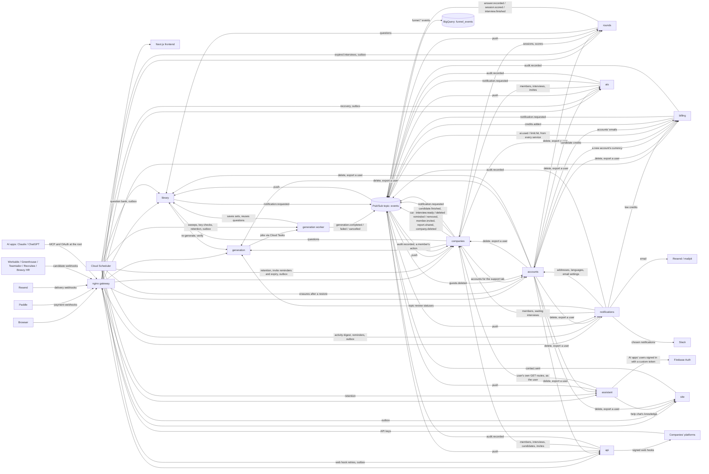

# Architecture

prepza is a set of Python API services behind an nginx gateway, with a Next.js frontend. They talk through signed internal calls and through events on one Pub/Sub topic.

- [Overview](#overview)
- [Services](#services)
- [How services work together](#how-services-work-together)
- [Background work](#background-work)
- [Events](#events)
- [Funnel events](#funnel-events)

## Overview

## Services

| Service | Responsibility |
|---|---|
| `library` | Question sets (topics and questions) of interviews and templates: the template catalog, the question bank's pools (company questions for interviews and reuse, practice questions for free practice); candidates' votes and reports (deleted and exported with the account when accounts asks), question quality flags and reuse |
| `generation` | The generation pipeline (a LangGraph graph, [diagram](generation.md#generation-pipeline)), run by its worker (`src/generation/worker_main.py`) as Cloud Tasks jobs; topic review, re-generating single questions, the question verifier, and scheduled sweeps |
| `rounds` | Candidates' interview sessions and their answers, free practice rounds. Its old content and contact routes send the browser to site, and its old `/internal/help/knowledge` forwards there, for one release |
| `companies` | Companies (unique names, logos, verification), members (owner, admins, viewers), interviews, candidate invites (one by one, in bulk, through a shareable link, with reminders), reports |
| `billing` | Companies' credit wallets (holds and charges), welcome credits, referrals, Paddle top-ups, automatic top-ups, refunds and chargebacks (webhooks); companies sets a candidate's credits aside and charges them through it. Serves a company's prices, currency, checkouts and automatic top-up to its members itself, checking membership with companies. Also stores every AI call's cost and every limit hit the services record (`ai.used`, `limit.hit`) for the admin zone's AI costs page, and keeps the usage limits superadmins edit, written to Redis for every service to read |
| `notifications` | Receives domain events pushed by Pub/Sub and sends emails through Resend (mailpit without a key): candidate invites and reminders, team invites, emailed PDF reports, contact messages to prepza's inbox, and to company members the daily activity digest, reminders (low credits, interviews nobody was invited to, topics waiting for review) and failed automatic top-ups; to many users at once, through its bulk sender, legal notices and superadmins' campaigns (product updates, offers), skipping its own suppression list of bounced and complaining addresses. Also the bell, with notifications for everyone (news, legal changes): stores the notifications other services ask for (`notification.requested`), removes a deleted company's (`company.deleted`), and streams them live to open tabs over server-sent events, through Redis pub/sub so every instance hears them (one subscription per instance, shared by its open tabs). Posts a company's chosen notifications to its Slack channel too, through the channel's incoming web hook. Signs emails' unsubscribe links and applies them (`/unsubscribe/{token}`, no sign-in): a user's email settings in accounts, a candidate's opt-out from a company's emails in its own database, checked before each invite and reminder |
| `ats` | ATS integrations (Workable, Greenhouse, Teamtailor, Recruitee, Breezy HR): companies' encrypted ATS keys, linked jobs and the candidates the ATSs send (their webhooks); invites them through companies and writes their results back to the ATS |
| `api` | The public API at `/api/v1/`: companies' API keys (as hashes, with their expiry), their web hooks (secrets encrypted) and deliveries; reads interviews and candidates and invites through companies, and sends a signed web hook when a candidate finishes |
| `assistant` | The in-app AI assistant ([feature page](features/assistant.md)): signed-in users' conversations, streamed over server-sent events (`POST /chat`), and tools made from the other services' user-facing GET routes, called with the user's own token. The tools are an allow-list (`src/assistant/constants/tools.py`) over committed OpenAPI snapshots of those services (`src/assistant/openapi/`, written by `scripts/assistant-openapi.sh`); a tool's data is trimmed for the model, and the panel's links are built only from the tool's link template and ids. Calls to companies carry a signed `X-Assistant` header, so companies audits those reads as the assistant's. It also serves those tools to the user's own AI apps over MCP at the site's root (`/mcp`, with its OAuth authorization server; [feature page](features/mcp.md)). It also runs the help chat that answers signed-out visitors in the same panel (`POST /help/chat`, [Public site](features/site.md#faq-and-help-chat)), from the knowledge site sends it |
| `accounts` | Users' accounts: the account settings (the interface language, on the Firebase sign-in), users' email settings with their consent log, the terms each accepted at sign-up, deleting and downloading an account across every service (companies first, as it may refuse; then the others at once; then its own rows with the erasure note, then the sign-in) and running those deletions again after a restore (`erasures`, 14 days), the admin zone's account lookups, email settings and sign-up stats, and the lookups other services make (addresses, languages and email settings for notifications' emails, account ids for its bulk sends, accounts for companies' support tab and billing's AI costs tab). Its account routes keep library's public addresses (`/library/me` and everything under it, `/library/superadmin/emails/...`, `/library/superadmin/stats`), which the gateway and the load balancer send to it; library's old internal routes forward to it, and its old public ones send the browser to `/api/accounts/...`, for one release |
| `site` | The public site's content (`src/site_content`, its own database `site`): the FAQ, the knowledge the help chat answers from (sent to the assistant at `/internal/help/knowledge`; the same knowledge as text at `/help/guide`, for signed-in users' assistant), each page's guide (`/help/pages/{key}`, for the info buttons and the assistant), the guide articles (read from `frontend/content`) the legal texts with every version (`/help/legal/...`), and the contact form (`/help/contact`, its messages kept as `contact.sent` events in its outbox until published, and a week after; deleted and exported with the account when accounts asks). Its routes keep rounds' public addresses (`/rounds/help/faq`, `/guide`, `/pages/...`, `/guides...`, `/legal/...`, `/contact`), which the gateway and the load balancer send to it (`locals.site_paths`) |
| `frontend` | Next.js app; server-rendered pages call the API through the gateway. Its code is in `frontend/src/` (pages in `app/`, laid out as `.claude/rules/nextjs.md` says); `messages/`, `content/` and `public/` stay beside it |

What each service does for users is described in the feature pages, linked from the [README](../README.md#documentation). Generation is described in [Generation and question quality](generation.md).

## How services work together

- **Databases:** each service owns its own Postgres database.
- **Internal calls:** services call each other's `/internal/` endpoints with short-lived signed tokens. The gateway never exposes those routes.
- **Requests per address:** each IP address gets about 600 requests a minute, after which it's answered `429` (Cloud Armor in production, `limit_req` in the local gateway). Static files outside `/api` don't count, and neither do the frontend's server-side calls (from the NAT's fixed address in production, the gateway's inner port 8081 locally, which the load tests use too). The services' own limits per user, company and address apply on top.
- **Shared code:** code the API services share (sign-in, service tokens, logging, database and HTTP setup) lives in [`packages/common`](../packages/common/README.md), its modules grouped by area (`prepza_common.<area>.<module>`: `ai`, `auth`, `config`, `db`, `events`, `http`, `i18n`, `limits`, `observability`, `redis`), installed into each service from the repo. The API images are therefore built from the repo root.
- **Compression:** every service gzips an answer of 1 KB or more for a client that takes gzip (`prepza_common.http.compression`), since only the frontend sits behind Cloud CDN, which compresses its pages; server-sent event streams (the assistant, the help chat, the bell) go out uncompressed, each event as it comes.
- **Paging:** every list endpoint takes `offset` and `limit`, at most 100 per page.
- **Sign-in:** users sign in with Firebase Authentication. The local setup uses the Firebase emulator, so no Firebase project is needed. Every service checks the ID token itself (`prepza_common.auth.auth`); a request that may change something (any method but `GET`, `HEAD` and `OPTIONS`) also asks Firebase whether the account still exists and its sign-ins weren't revoked, so a deleted account can't change anything with a token it still holds (reads accept it until it expires, within the hour). Deleting an account revokes its sign-ins before deleting it.
- **AI apps' calls:** an AI app connected over MCP holds an opaque token prepza issued (OAuth 2.1 with PKCE). For each of its calls the assistant signs the user in with a Firebase custom token, exchanged for the user's ID token (kept until shortly before it expires), and calls the services with it as the panel does; the services check it like any user's ([AI apps over MCP](features/mcp.md#calling-the-services-as-the-user)).

## The "I'm not a robot" check

Where a script could spend a company's credits or prepza's AI capacity, the browser shows it's a person first, with Cloudflare Turnstile: a new candidate starting through a job ad's link, a person's first company (it gets the welcome credits), an unpaid company's topic review (before the questions are generated), the contact form, and a visitor's help chat until it has a reply (the chat has no id to remember a passed check by; a reply is signed by the chat, so one made up doesn't count).

- When such a form appears, the page connects to Cloudflare, loads Turnstile's script and renders its invisible widget (`frontend/src/hooks/use-human-check.ts`); on sending, the browser only runs the check for a one-time token (`frontend/src/lib/human-check.ts`: most people see nothing; the few Cloudflare isn't sure about get a small challenge at the bottom of the screen) and sends it in `X-Human-Check`. Other pages never load Turnstile.
- The service checks it with Cloudflare (`prepza_common/auth/human_check.py`, `require_human`), with `TURNSTILE_SECRET_KEY`: missing or refused, a 403 saying so. Without the secret there's no check; if Cloudflare doesn't answer, the request goes through, as the routes keep their rate limits.
- The in-app assistant and AI apps create companies and approve topics from the server, with no browser to ask: their requests (`X-Assistant`, signed) aren't checked.
- Locally and in CI, Cloudflare's test keys pass every check (and the browser tests' dummy token `XXXX.DUMMY.TOKEN.XXXX`); production has its own keys: the site key is built into the frontend (`NEXT_PUBLIC_TURNSTILE_SITE_KEY`), the secret is in Secret Manager.
- Cloudflare sees the visitor's browser signals and address, so it's in the privacy policy and, for candidates, a sub-processor in the DPA (both from their 2026-10-23 versions): production sets the secret only once those apply.

## Background work

| Kind | In Google Cloud | Examples |
|---|---|---|
| Long jobs | Cloud Tasks that call the generation worker's `/internal/jobs/...` | A generation, a question check |
| Periodic work | Cloud Scheduler calling `/internal/schedules/...` ([`infra/terraform/jobs.tf`](../infra/terraform/jobs.tf)) | Every minute: outbox flushes (library, companies, rounds, site, generation worker, ats, billing, notifications, api) and interviews whose time ran out (rounds). Every 5 minutes: stuck-generation sweeps, web hook retries (api) and the edited limits written to Redis again (billing). Every 10 minutes: key-check batches and ATS recovery (waiting and stalled ATS invites, kept ATS results, ATS candidates past retention). Daily: retention of generations, of candidates and the company action log (12 months), of the assistant's idle conversations, AI apps' expired connections and apps idle for 30 days, and of billing's AI usage and limit hits (13 months) and limit changes (24 months); invite expiry and reminders; the question bank's stages; the last 14 days' account deletions run again (accounts), so a restored backup brings nobody back. Every minute for an hour each morning: the activity digest (from 7:00 UTC) and member reminders (from 8:00), each run going on where the last stopped. Every minute from 8:00 to 18:59 UTC: the bulk sender (legal notices and campaigns), each run sending the next pending recipients for 40 seconds |

- Google signs those calls, and Pub/Sub pushes, as one invoker service account, which each service checks.
- Locally there is no queue: the API calls the worker directly.
- Locally, a small `scheduler` container runs [`scripts/local/crontab`](../scripts/local/crontab).

## Events

Domain events go through an outbox in library, generation, rounds, site, companies and ats, and members' actions for a company's action log (`audit.recorded`) through one in billing, notifications and api too (ats sends its own through its outbox), so a change never loses its event:

1. An event is saved in an `outbox` table, in the same transaction as the change it announces.
2. It is published right after. A request publishes only the events it saved, in one batch, with a 5-second timeout.
3. If that failed, a per-minute scheduled flush publishes it. Each run sends batches of 100 until none wait, for up to 20 seconds, so a backlog after an outage drains in minutes; two runs never send the same row.

Billing's outbox carries its members' actions (a top-up paid), `credits.added` and the bell's notices of referral rewards and automatic top-ups charged, each saved with the credits it announces; a declined automatic charge's notice goes through it too, in a transaction of its own right after the decline is counted. A top-up's webhook flushes the outbox with a 5-second timeout, so Paddle's answer is never held up; what it couldn't publish goes with the outbox's next run. Notifications and api publish no domain events but their members' actions (Slack connected or changed; API keys and web hooks, and a stopped web hook's notice), and the assistant none. Apart from them, every service publishes its records of AI calls and limit hits (`ai.used`, `limit.hit`) straight away, without an outbox, as an AI call changes no row they could be bound to; a publish is tried 3 times, then logged, and the log line keeps the cost for the spend alert ([Credits and payments](features/billing.md#ai-usage-and-limit-hits)).

Refusals and duplicates:

- An event Pub/Sub refuses is counted in its row's `attempts`, and parked after 5 refusals, so it can't hold up the rest. A parked event is logged as an error, which Sentry reports.
- Each event also carries the trace of the request that saved it (the outbox row's `trace`, sent as the `trace` attribute), and the consumer's log lines, calls and events carry it on, so a user's action and everything its events cause read as one trace in Cloud Logging.
- Each event carries a stable `event_id` attribute (its outbox row id), so a consumer that gets it twice acts once. Library's statistics and companies keep the ids they handled in `processed_events` (companies stores an `audit.recorded` event once by its id in `audit_events.event_id`, at the time it happened, so a late one keeps its place in the log); notifications passes the id to Resend as the email's idempotency key and stores one bell notification per key; api records each web hook's delivery per event; ats invites a candidate once (a unique key and a claim), sends a result back once (`reported_at`) and deletes idempotently.

Delivery:

- All events go to one Pub/Sub topic, `events`.
- It pushes each event to the `/internal/events` endpoint of library, rounds, companies, notifications, ats, api, assistant, billing and accounts.
- In Google Cloud, each subscription carries only the types its consumer handles ([`infra/terraform/pubsub.tf`](../infra/terraform/pubsub.tf), `locals.consumes`):

| Consumer | Event types |
|---|---|
| library | `answer.recorded`, `session.scored`, `guests.deleted` (companies deleted guest invites, by removal, retention or with their interview or company: library deletes each guest's ratings and reports; deleting again deletes nothing more), `question.fixed` (its own: a fixed bank question's copies in companies' tests that still hold its old content get the new one, 50 at a time; a push that runs out of time answers 503 and Pub/Sub brings it back for the rest; a copy already fixed no longer matches, so a repeat fixes nothing twice), `interview.deleted` (the interview's question set, found by its id or by the generation that saved it, of that company only), `company.deleted` (every set of the company, 20 at a time); deleting again deletes nothing more |
| rounds | `interview.deleted` (by its set: every candidate's and preview's sessions with their answers and signals), `company.deleted` (every session of the company); deleting again deletes nothing more, so a redelivery or a repeat is safe in any order |
| companies | `generation.completed`, `generation.failed`, `generation.cancelled`, `interview.finished` |
| notifications | `notification.requested`, every `candidate.*` (it handles `candidate.invited`, `candidate.joined`, `candidate.reminded`, `candidate.removed` and `candidate.interview_deleted`, which companies sends with `interview.deleted` so the bell forgets a deleted interview's candidates), `member.invited`, `report.shared`, `contact.sent`, `company.deleted`, and its own `email.webhook_received` (a Resend web hook recorded by its delivery id before the answer; its work runs from the event) |
| ats | `candidate.finished`, `candidate.removed`, `interview.ready`, `interview.deleted`, `company.deleted`, `credits.added`, and its own `ats.candidate_arrived` (a candidate an ATS's web hook sent, saved before the answer: invited from the event, once, as the invite claims them) |
| api | `candidate.finished`, `candidate.removed`, `candidate.interview_deleted` (its candidates' results waiting to be sent again go), `company.deleted` |
| accounts | `guests.deleted` (deletes each guest's sign-in and accepted terms; deleting again deletes nothing more) |
| assistant | `company.deleted` (deletes the company's conversations), `candidate.removed` and `candidate.interview_deleted` (deletes the company's conversations that mention the erased candidate's email or invite, or the deleted interview); deleting again deletes nothing more |

- Locally, each consumer ignores events that aren't its own.
- Locally, Google's Pub/Sub emulator runs in docker-compose, and [`scripts/local/pubsub-setup.sh`](../scripts/local/pubsub-setup.sh) creates the topic and subscriptions at every start of the emulator, which keeps nothing over a restart.

The event types each service publishes are in the [overview diagram](#overview).

## Funnel events

The services also publish small `funnel.*` events (signed up, company created, candidate invited, results viewed, topped up and so on) to the same topic.

- A filtered BigQuery subscription stores them for the dashboards (`funnel_events`).
- The push subscriptions skip them.
- They carry counts and a salted hash of the user id (`ANALYTICS_SALT`), never emails or text.
- Locally, nothing stores them.
